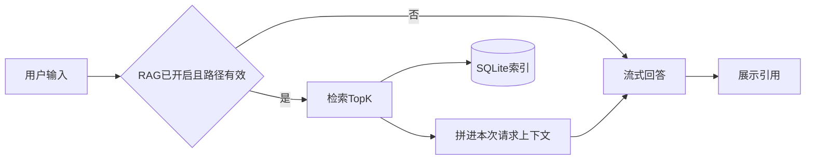

# RAG 计划

在现有对话上增加本地知识库：设置里填写一个文件夹并打开 RAG，之后每条用户消息先在该目录的 Markdown 里检索，再把命中段落交给同一套 OpenAI 兼容模型作答。技术约定见 [技术选型.md](./技术选型.md) 第 4 节，表结构见 [架构设计.md](./架构设计.md)。

## 用户怎么用

1. 打开设置，填写知识库路径（例如 Obsidian 库根目录），勾选「开启 RAG」，保存。
2. 应用在后台扫描该目录下的 `.md`，建立索引。设置页显示进度：已索引文件数、块数、最近一次完成时间。
3. 回到聊天，按平时方式输入问题（例如「拉萨旅行计划里哪天去布达拉宫」）。
4. 回答依据检索到的段落生成，气泡下方列出引用：相对路径 + 标题路径。点击引用用系统默认程序打开对应 Markdown。
5. 关闭 RAG 后，对话恢复为现在的纯聊天，索引保留，下次打开可继续用。

路径必须是已存在的目录。保存时校验；目录不存在则提示，不写入设置。

## 一次提问的数据流

检索发生在发模型请求之前，跑在工作线程，主线程只更新「正在检索…」和之后的流式气泡。命中的原文只出现在这一次发给模型的消息里，不写入 `messages` 表，聊天记录仍是用户原话和助手回答。

## 设置项

都存在现有 `settings` 表：

| 键 | 含义 |
|----|------|
| `rag_enabled` | `1` / `0` |
| `rag_path` | 知识库根目录的绝对路径 |
| `embedding_model` | 语义检索用的模型名；留空则只用关键词 |

界面加在现有设置对话框：路径输入框 + 浏览按钮、RAG 开关、embedding 模型名、索引状态一行、「重建索引」按钮。聊天标题栏在 RAG 开启时显示当前目录名，便于确认正在查哪一个库。

## 索引

模块放在 `talk2/core/rag.py`，存储扩展 `talk2/core/storage.py`。

扫描规则：

- 从 `rag_path` 递归读取 `.md`。
- 跳过 `.obsidian`、`.git`、`node_modules` 这类目录。
- 文件按 UTF-8 读取；读失败的文件跳过，并在索引状态里计数。

切块：

- 按 ATX 标题（`#` 到 `######`）切开，记下标题路径，例如 `旅行/拉萨.md › 行程 › 第三天`。
- 标题前的前言单独成块。
- 单块超过约 1200 字时按空行再切，相邻块保留一小段重叠，避免一句话被切丢。
- 过短的块（只有标题、没有正文）并入下一块。

落库（与架构文档一致）：

- `kb_files`：相对路径、`mtime`、大小。
- `kb_chunks`：所属文件、标题路径、正文、embedding（可空）。
- `kb_chunks_fts`：FTS5，供关键词检索。中文写入前用 `jieba` 分词。

增量：文件 `mtime` 与已记录的一致则跳过。保存设置、点「重建索引」、以及 `QFileSystemWatcher` 发现变更时，在工作线程里刷新。换了一个根目录则清空旧索引再全量重建。

语义向量：对每个块调用同一 `base_url` / `api_key` 的 embeddings 接口，模型名用 `embedding_model`。向量以 JSON 存在 `kb_chunks.embedding`。查询时用 `numpy` 算余弦相似度。embedding 调用失败或未填模型时，该块仍留在 FTS 索引里，检索走关键词。

## 检索与回答

对用户当前这句话做两路检索，各取若干条，按块 id 去重后保留 Top-K（默认 6）：

- 关键词：FTS5，适合「拉萨旅行计划」这类标题和专有名。
- 语义：把当前这句话 embed 后与库中向量比相似度。未启用 embedding 时跳过这一路。

拼进模型请求的上下文放在 system 与历史消息之间，内容包括每段的路径、标题路径、正文，并要求回答依据这些段落，引用对应编号。找不到相关段落时，模型说明库里没有对应内容。

助手气泡渲染完成后，在气泡下显示本次实际注入的引用列表。

## 代码落点

| 位置 | 改动 |
|------|------|
| `talk2/core/rag.py` | 扫描、切块、索引、检索、拼上下文 |
| `talk2/core/storage.py` | `kb_*` 表与读写 |
| `talk2/core/llm_client.py` | embeddings 调用，与聊天共用配置 |
| `talk2/ui/settings_window.py` | 路径、开关、模型名、重建索引、状态 |
| `talk2/ui/chat_window.py` | 发送前检索，引用区，标题栏状态 |
| `talk2/ui/stream_worker.py` | 工作线程里先检索再流式，检索状态用信号回主线程 |
| `requirements.txt` | `jieba`、`numpy` |

UI 继续只通过 `core` 访问文件和数据库。索引与 embedding 不在 Qt 主线程里做。

## 实现顺序

1. 设置项与目录校验；扫描、切块、FTS5 入库；设置页能看到索引数量。
2. 对话在 RAG 开启时走关键词检索，注入上下文并流式作答，气泡下显示引用，点击可打开文件。
3. embedding 模型、向量入库、与关键词融合排序。
4. 按 `mtime` 增量更新，并用 `QFileSystemWatcher` 在文件变化后刷新。

每一步都可以单独试用：第 2 步完成后，只填路径并打开 RAG，就能按对话框里的问题在 Markdown 里查找并回答。

## 验收

- 设置一个含多篇 `.md` 的目录并打开 RAG，保存后索引数量大于 0。
- 提问「拉萨旅行计划」，回答能定位到对应笔记，引用路径与标题正确，点击能打开该文件。
- 关闭 RAG 后，同一句话不再附带知识库引用，行为与现在的聊天一致。
- 改一篇笔记再保存，再次提问能用到新内容。
- 索引或 embedding 失败时，聊天窗口给出明确状态，已有对话记录不受影响。

## 修订记录

- 2026-09-28：初稿。对齐现有对话实现与技术选型中的 FTS5 + embeddings 方案。
