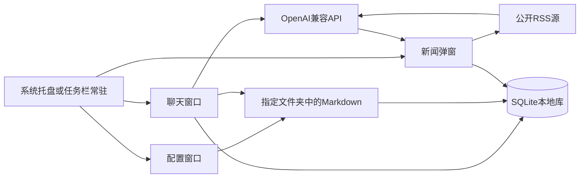

# 架构设计

本文描述 Talk2 如何按 [技术选型.md](./技术选型.md) 落地：进程模型、模块边界、数据流、存储与平台差异。产品范围见 [产品介绍.md](./产品介绍.md)。

## 进程与数据流

单进程桌面应用：Qt 主线程只做 UI；网络、RSS、模型流式输出在 worker 线程，用 signal 回主线程。



新闻链路：到点（或用户点「立即推送」）→ 拉 RSS → 截断标题/摘要 → 同一套 LLM 客户端摘要成 10 条 → 独立弹窗；模型调用失败时展示原始 Top 10。

知识库链路：设置中选定文件夹 → 扫描 `.md` 按标题切块 → FTS5 与 embeddings 写入 SQLite → 用户提问时融合检索 Top-K → 带引用注入对话上下文并流式作答。

## 建议目录

实现阶段可按下面拆分，名字可微调。UI 通过 `core` 访问网络与存储。

```text
talk2/
  main.py                 # 入口：单实例、托盘、事件循环
  ui/
    chat_window.py
    settings_window.py
    news_popup.py
    tray.py
  core/
    llm_client.py         # OpenAI 兼容、流式与 embeddings
    storage.py            # sqlite3、FTS5
    news_fetcher.py       # RSS
    rag.py                # Markdown 切块、索引、融合检索
    scheduler.py          # QTimer，到点回调主线程
    platform.py           # 路径、自启、托盘可用性、字体
    secrets.py            # keyring 封装与内存回退
  resources/              # 图标等
```

用户数据放在各系统规范目录：

| 用途 | Windows | Linux |
|------|---------|-------|
| 数据库、日志、锁文件 | `%APPDATA%\Talk2\` | `~/.local/share/Talk2/` |
| 非敏感配置 | 同上或拆分子目录 | `~/.config/Talk2/` |
| API Key | Windows 凭据管理器 | Secret Service |

路径一律经 `platformdirs`，由 `core/platform.py` 对外给出；自启与托盘差异也集中在这一层。

## 存储

SQLite + WAL。短连接或由主线程串行访问即可；worker 写入聊天增量时，每个线程使用独立连接。

建议表：

- `conversations`：`id`，`title`，`created_at`，`updated_at`
- `messages`：`id`，`conversation_id`，`role`，`content`，`created_at`，`token_usage`（可选）
- `news_digests`：`id`，`fetched_at`，`items_json`，`raw_source_count`，`model`，是否经过摘要
- `kb_files`：知识库文件相对路径、`mtime`、体积
- `kb_chunks`：所属文件、标题路径、正文、embedding
- `kb_chunks_fts`：FTS5 虚拟表，供关键词检索
- `settings`：非敏感配置键值（含知识库根目录）；密钥走 keyring

备份：拷贝数据目录里的 `talk2.db`。

## 常驻、托盘、单实例

- 启动时用数据目录下的 `QLockFile` 保证单实例。
- 系统托盘可用时：关闭聊天窗隐藏到托盘，托盘菜单提供打开聊天、设置、立即推送新闻、退出。
- 部分桌面环境没有传统托盘：主窗口最小化到任务栏，退出走明确的退出操作。

## 定时与弹窗

- `QTimer` 按用户配置的本地时刻触发；回调里切回主线程再开 `NewsPopup`。
- 弹窗独立于聊天窗：置顶尽力而为（`show` / `raise_` / 激活）。
- 辅助：托盘 `showMessage()`。
- 开机自启是设置项：
  - Windows：当前用户 Startup 快捷方式
  - Linux：`~/.config/autostart/talk2.desktop`

## 打包

- `scripts/build.py` 调用 PyInstaller，在对应操作系统上执行：Windows 打出 `dist/Talk2/Talk2.exe`，Linux 打出 `dist/Talk2/Talk2`。
- 产物是单目录，内含 Qt 平台插件与 jieba 词表，HTTPS 使用操作系统证书库。步骤见 [打包.md](./打包.md)。
- 打包后的开机自启指向该可执行文件。开发运行仍使用 `python -m talk2`。

## 落地顺序

1. 聊天窗口 + API 设置 + SQLite + 流式对话与 Markdown 渲染；路径与密钥走 platformdirs + keyring。
2. 托盘常驻；无托盘环境回退任务栏窗口；单实例锁。
3. RSS + AI 摘要 10 条 + 手动「立即推送」+ 新闻弹窗。
4. 每日定时 + 双平台开机自启。
5. 指定文件夹 Markdown 索引、FTS5 + embeddings 检索、对话引用与打开原文件。
6. 打包说明。

## 修订记录

- 2026-10-13：打包改为 `scripts/build.py` 产出的单目录。
- 2026-09-18：加入 Markdown 知识库索引、检索与对话引用。
- 2026-09-18：与产品介绍对齐，补充 Markdown 渲染与定时 Agent 表述。
- 2026-09-18：初稿，对应 Windows 与 Linux 选型结论。
